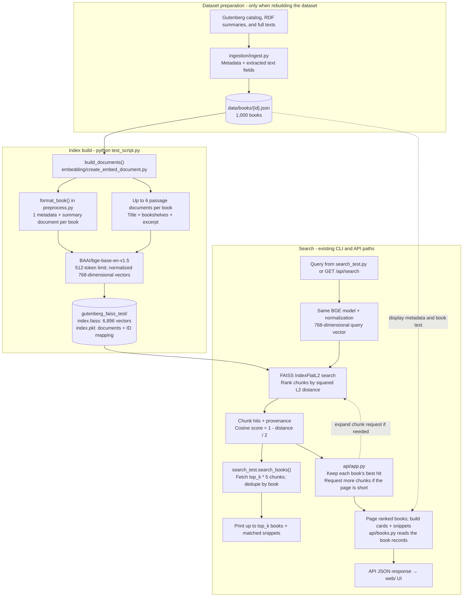

**Pure** semantic retrieval system built over 1,000 English nonfiction Project Gutenberg books using **LangChain**, **FAISS**, and **`BAAI/bge-base-en-v1.5`**. Rather than relying on surface-level keyword matching, the engine indexes both book-level catalog metadata/summaries and sampled in-text passages so users can search by theme, concept, or narrative situation.

---

## Architecture & What's Done

### Pipeline architecture

The diagram shows the current implementation. The dataset is committed; normal setup starts with `test_script.py`, without rerunning ingestion. Index construction happens once per dataset or embedding-format change; query embedding happens on every search.



The backend in `api/searchers.py` loads the model/index and returns chunk hits. `api/app.py` owns book deduplication and paging; the CLI has its own deduplication loop. The index carries `gutenberg_id`, `doc_type`, and `passage_index` so results can be traced back to the source record. Contents and introductions reach the detail panel through the JSON records, but are not currently embedded. There is no reranker or relevance cutoff in this diagram.

### 1. Multi-Granularity Document Indexing (6,896 Vectors)
Each book JSON in `data/books/` is expanded into up to **7 dense vector documents** inside `embedding/create_embed_document.py`:
* **1 Catalog & Summary Document (`doc_type="summary"`):** Combines `title`, `contributors`, `subjects`, mapped Library of Congress (`locc`) classifications, and `description` via `format_book()`.
* **Up to 6 Passage Documents (`doc_type="passage"`):** Indexes each ~400-character excerpt from `book["passages"]` (971 of the 1,000 books contain all 6 passages), prefixed with the book's `Title` and `Subjects` so individual snippets retain book-level context.

### 2. Embedding & Vector Store Setup
* **Model:** `BAAI/bge-base-en-v1.5` (upgraded from `all-MiniLM-L6-v2`'s 384 dimensions to 768 dimensions, 512-token context window) with L2 normalization enabled (`normalize_embeddings=True`).
* **Index Persistence:** Built once via `test_script.py` and saved locally to `gutenberg_faiss_test/`. `search_test.py` and the API reuse that index; each process still loads the embedding model at startup.

### 3. Book-Level Deduplication & Similarity Scoring
* **Deduplication (`search_books`):** Fetches `top_k * 5` candidate vectors from FAISS and filters duplicate `gutenberg_id` hits so multiple passages from the *same* book do not crowd out distinct books covering the same topic.
* **Similarity Readout:** Converts FAISS squared L2 distances on unit vectors into cosine similarity scores (`1.0 - l2_distance / 2.0`), ranked highest first. Cosine similarity ranges from `-1.0` to `1.0`; it is not a probability of relevance.
* **Provenance Tracking:** Displays whether each result matched via `summary` or `passage`, along with the triggering snippet.

---

## Repository Structure

```text
.
├── data/
│   └── books/                     # 1,000 pre-ingested Project Gutenberg JSON records
├── embedding/
│   ├── preprocess.py              # LoCC mapping and format_book() metadata formatter
│   └── create_embed_document.py   # Builds summary + passage LangChain Documents
├── gutenberg_faiss_test/          # Saved FAISS vector index (6,896 vectors)
├── test_script.py                 # Builds and saves the FAISS index from data/books/
└── search_test.py                 # Loads FAISS index and runs deduplicated semantic queries
```

## Local setup and baseline

Follow the root [README](../README.md) to create `.venv` and install the dependencies. Run `python test_script.py` once, then `python search_test.py`; edit `query` in the latter to try another search. The first build downloads the model into the Hugging Face cache. Subsequent builds reuse it. After that download, `HF_HUB_OFFLINE=1` can be set when running either script or the API to use the cached model without network checks.

Verified on 2026-11-13 with Python 3.13.5 on an Apple Silicon Mac: 1,000 books produce 6,896 normalized, 768-dimensional vectors, using PyTorch's MPS device. All 29 API tests pass. The CLI and live API agree on the top five books and scores for all four UI example queries; API pagination and book details also pass smoke checks. The local comparison results are saved in gitignored `data/raw/search-baseline-2026-11-13.json`, with resolved package versions in `.venv/requirements-resolved.txt`. These are behavior checks, not relevance judgments.

Before changing retrieval:

* `table_of_contents`, `introduction`, `conclusion`, and `index_terms` are currently not embedded. Displaying contents and introductions in the UI does not make them searchable.
* The model truncates input at 512 tokens. Tokenizing the current documents found no over-limit inputs, but the longest summary uses 507 tokens (median 282); passages peak at 357. Adding fields requires a token budget or additional documents so the new content is actually embedded.
* The CLI deduplicates a fixed `top_k * 5` chunk pool, which can yield fewer than `top_k` books. The API expands its pool until it can fill the requested page. A reranker needs 15–20 **unique books** before rescoring, and both entry points need to use the same ranking behavior.
* Keep any relevance cutoff dependent on labeled evaluation results; cosine scores alone do not establish a useful threshold.

## Proposed experiments (not implemented)

### Enrich the searchable text

Contents are present for 672 books and introductions for 633. They can provide topic coverage missing from a broad summary or six sampled passages, but an introduction may also contain acknowledgments or other weak retrieval evidence. Test contents and introductions separately before combining them.

A tokenizer-only check on 2026-11-13 appended each nonempty field after the current `format_book()` output, using labeled fields and semicolon-separated contents entries. It did not rebuild the index:

| Fields appended to the current summary document | Documents exceeding 512 tokens |
|---|---:|
| None | 0 / 1,000 |
| Table of contents | 293 / 1,000 |
| Introduction | 602 / 1,000 |
| Both | 680 / 1,000 |

Prefer adding documents for contents/introduction sections in `build_documents()`, retaining the existing summary and passage documents. Split long sections to fit the model's tokenizer budget, including their title/subject headers, and preserve book ID and section provenance. This gives the added text its own retrieval opportunity. If the experiment must be confined to `format_book()`, explicitly budget tokens among fields; appending all available text will silently discard some of it. Either approach requires rebuilding the index. New section types also need accurate snippet selection and labels in the API/UI.

### Rerank a shortlist of unique books

A cross-encoder reads the query and candidate text together, making it a reasonable experiment for context-sensitive errors such as a river bank versus a financial bank. It can reduce these errors, but cannot guarantee their removal or recover a relevant book absent from the shortlist. This is the standard [retrieve-and-rerank approach](https://www.sbert.net/examples/sentence_transformer/applications/retrieve_rerank/README.html).

Start with 20 unique books, expanding the FAISS chunk request until that many are available or the index is exhausted. For each book, supply a token-budgeted profile with title, subject headings, summary, and the best matching passage when available; reserve room for the query and matched evidence. Retain provenance. Reuse the existing index for this first reranking experiment, keeping retrieval and reranking effects separable.

Start with `BAAI/bge-reranker-base` as the smaller local baseline (278M parameters), then compare `BAAI/bge-reranker-v2-m3` (568M parameters) on the same candidates. These sizes come from the [BGE reranker documentation](https://bge-model.com/bge/bge_reranker.html) and [v2 documentation](https://bge-model.com/bge/bge_reranker_v2.html); neither model's quality or latency has been measured on this corpus/Mac yet. Both model cards support Sentence Transformers' `CrossEncoder`, already available through the project's dependencies: [base](https://huggingface.co/BAAI/bge-reranker-base), [v2-m3](https://huggingface.co/BAAI/bge-reranker-v2-m3).

Rank the complete shortlist before paging, and preserve that ordering across pages. A fixed shortlist of 20 books supports at most two 10-result pages; the UI's existing "Show more" behavior must reflect that limit. Use one shared ranking path for the CLI and API. Preserve retrieval cosine separately from reranker scores and update `score_kind` plus the UI's hardcoded cosine explanation. Applying a sigmoid only rescales a reranker score; it does not establish calibrated relevance probabilities.

### Evaluate before selecting a cutoff

See [evaluation/README.md](../evaluation/README.md) for the starter query set, blank candidate-labeling worksheet, and step-by-step grading instructions.

Start with 40–60 queries spanning subjects actually present in the corpus, including clear topical queries, ambiguous terms with disambiguating context, and queries with no useful answer in this 1,000-book subset. Pool candidate books from the compared systems, hide system identity/order, and assign book-level judgments: 0 = irrelevant, 1 = tangential, 2 = useful. Agree what counts as useful with the team; double-label a subset to catch disagreements.

Compare the current baseline, contents-only enrichment, introduction-only enrichment, reranking alone, and the best enrichment plus reranking. Track candidate Recall@20 against the known judged relevant books (not exhaustive corpus recall), Precision@5, graded nDCG@10, and query latency. Also record how often a no-answer query displays any result. Do not inject known relevant books into the reranker's candidate list: retrieval misses must remain misses in the end-to-end evaluation.

Split by query, keeping near-duplicate intents together. Tune a cutoff on development queries only, for the final chosen model and scoring method, then report retained useful results and false positives on held-out queries, broken down by subject. A single global threshold may not separate the score distributions well enough; keep the existing no-cutoff behavior if that tradeoff is poor. BGE's [score guidance](https://huggingface.co/BAAI/bge-base-en-v1.5#frequently-asked-questions) also recommends choosing thresholds from task-specific data. The four saved UI examples are smoke checks, not sufficient threshold-calibration data.
